[← Back to Midwest Technology Home](../README.md)

# Phase 01 — Infrastructure

**Status: In Progress**

In this phase, I built the foundation of my homelab using Windows Server 2022, Hyper-V, Active Directory, DNS, and DHCP. This page documents the work I have completed and verified so far. I will keep adding to it as I expand the infrastructure.

## 1. Building a Budget Homelab

I wanted a practical way to learn Windows Server administration and networking without buying expensive enterprise equipment. I put together a working homelab using computer parts I already had. This gives me a place to build, troubleshoot, test changes, and document what I learn.

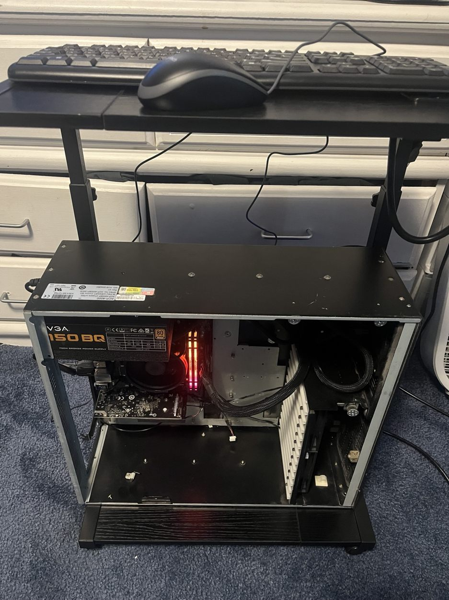

**Figure 1 — Physical homelab:** My budget server build.

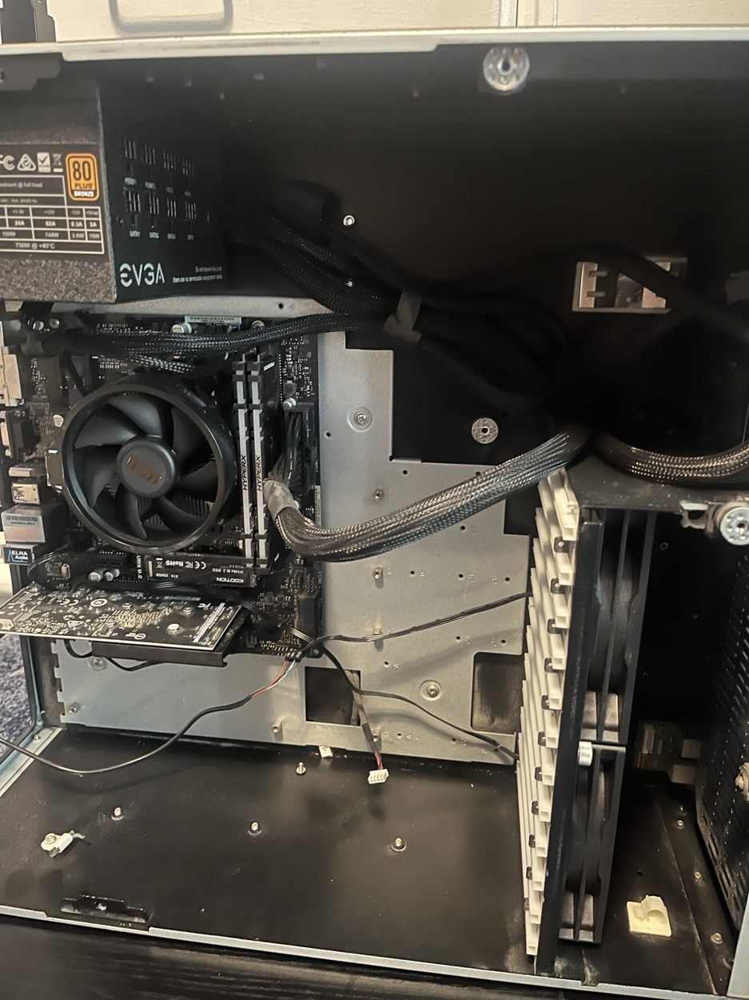

**Figure 2 — Server components:** The physical computer used to run my Windows Server and Hyper-V environment.

## 2. Current Homelab Topology

This diagram shows the environment as it is configured **right now**. LAB-HV1 uses a Wi-Fi-connected External Hyper-V virtual switch, and the virtual machines are currently on my home network. It does not show future network isolation as completed.

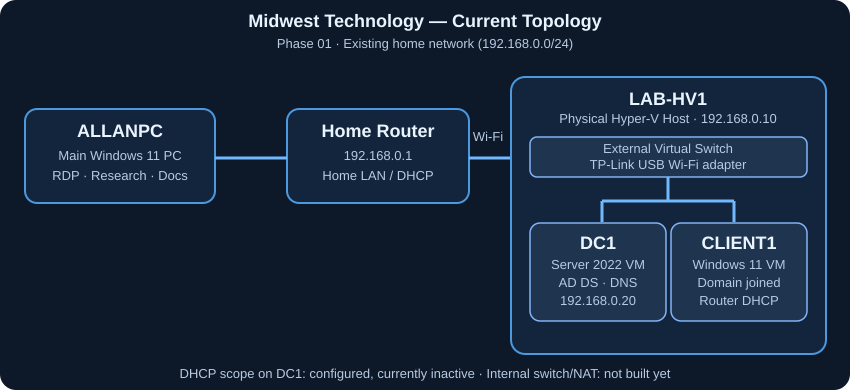

**Figure — Current Homelab Topology:** Existing home network and Hyper-V virtual machines (not the proposed isolated design).

**Current-state note:** DC1 provides Active Directory and DNS. Its original DHCP scope exists but is intentionally inactive while the VMs share the home network. This diagram will be updated as the lab evolves.

## 3. Windows Server 2022 and Hyper-V Setup

### Step 1 — Prepare the physical server

I installed Windows Server 2022 on my physical homelab computer and configured it as the foundation for the environment. The original installation wizard was not captured, so the current Server Manager view documents the installed system.

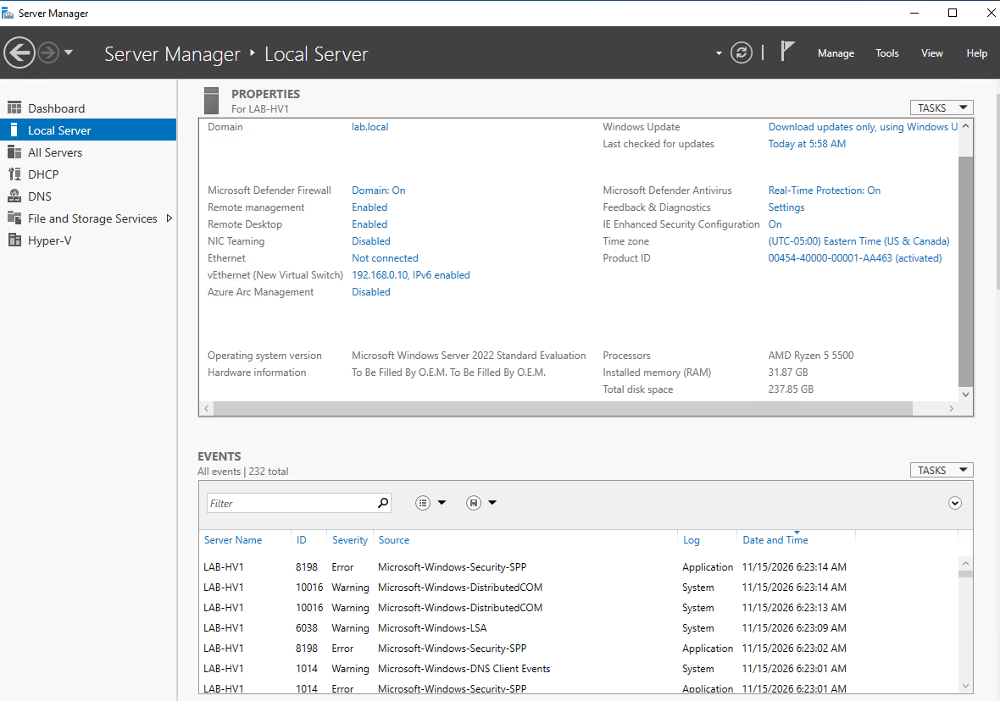

**Figure 3 — Windows Server installation:** LAB-HV1 running Windows Server 2022 with Hyper-V available.

### Step 2 — Configure Hyper-V and create virtual machines

I installed Hyper-V and created a Windows Server 2022 virtual machine for DC1 and a Windows 11 virtual machine for CLIENT1. This allows me to run the domain controller and client independently on the physical host.

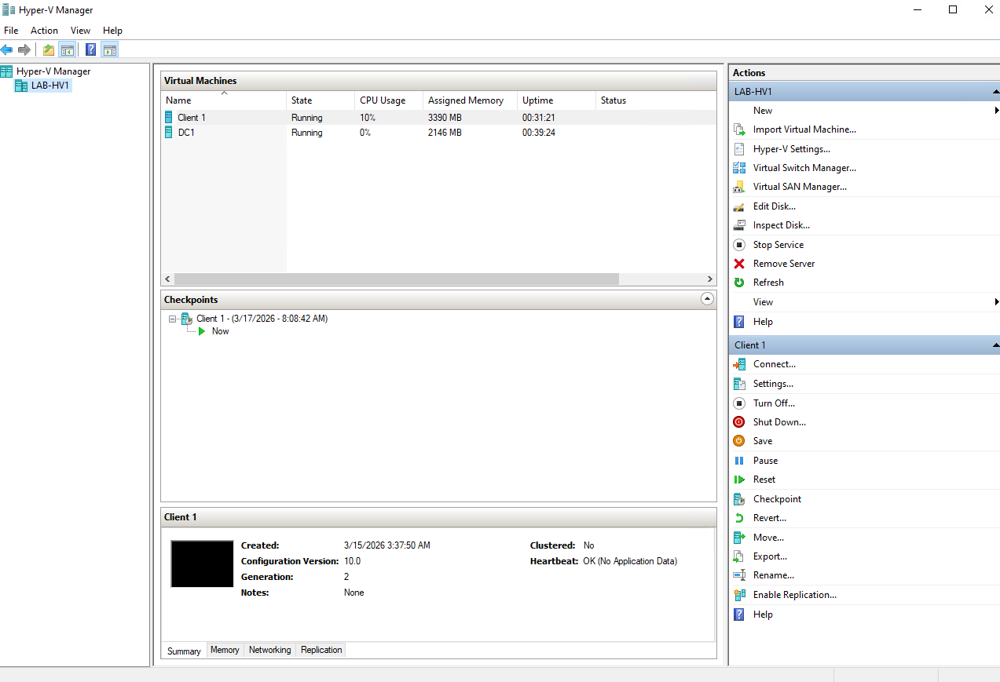

**Figure 4 — Hyper-V virtual machines:** DC1 and CLIENT1 appear in Hyper-V Manager.

### Step 3 — Configure the external virtual switch

I configured an External virtual switch using the TP-Link USB Wi-Fi adapter. The management operating system shares the connection, allowing LAB-HV1 and the VMs to communicate over the existing home network.

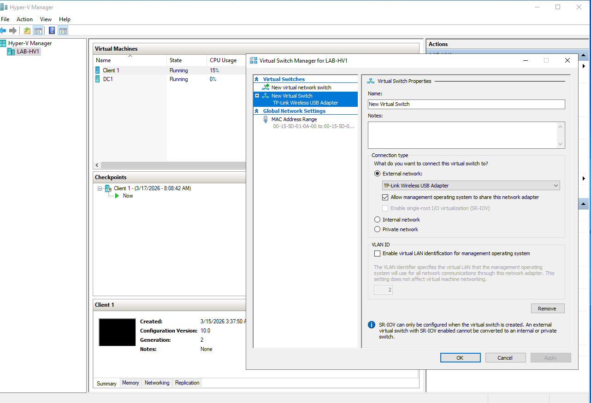

**Figure 5 — External virtual switch:** Current Hyper-V network settings using the wireless adapter.

## 4. Migrating Active Directory to DC1

I originally configured Active Directory directly on my physical Windows Server. I later moved the domain controller role into a dedicated virtual machine so that DC1 could be maintained without restarting the physical Hyper-V host. I verified the new domain controller before demoting the original physical server.

> The next screenshots are from the actual **November 1 migration**. They show historical IP addresses from the original environment, before I changed the network to its current 192.168.0.x configuration.

### Step 4 — Install Active Directory Domain Services

On DC1, I used Server Manager to install the Active Directory Domain Services role. I checked the installation results before moving on to promotion.

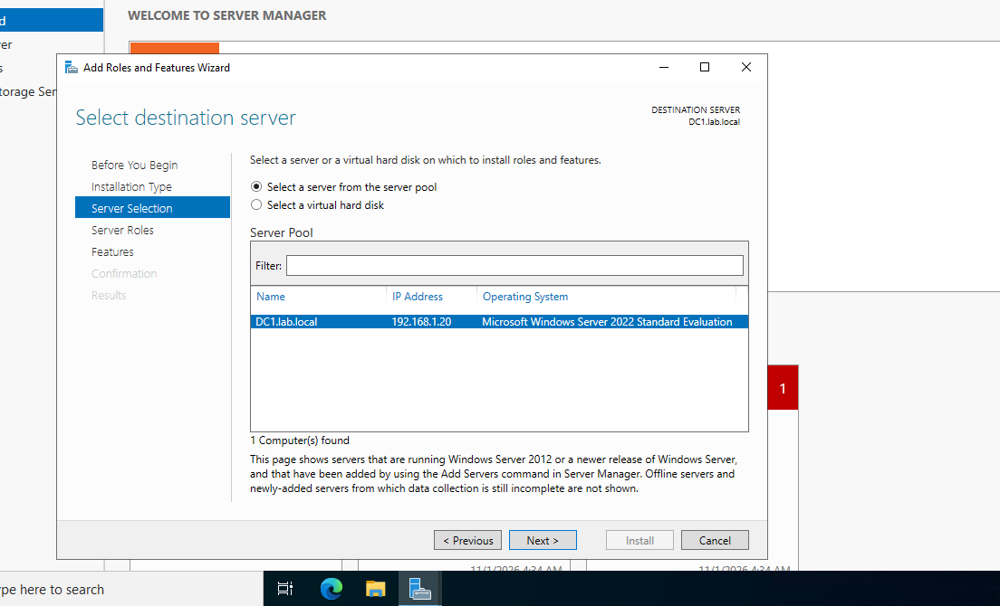

**Figure 6 — AD DS installation:** Installing Active Directory Domain Services on the DC1 virtual machine. Historical configuration — November 2026

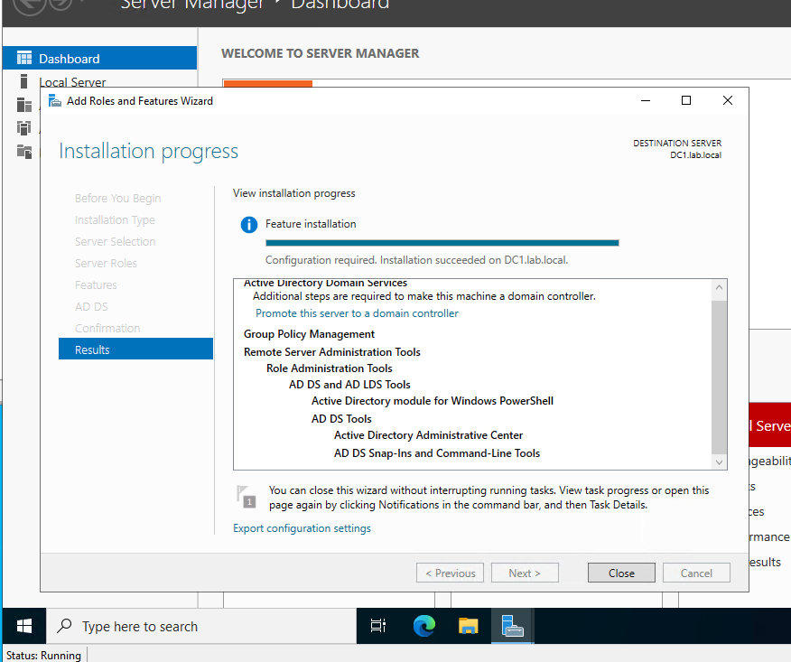

**Figure 7 — AD DS role installation results:** Server Manager shows the role installation succeeded and domain controller promotion was the next step. Historical configuration — November 2026

### Step 5 — Promote DC1 into the existing domain

I selected **Add a domain controller to an existing domain** and entered my existing `lab.local` domain. I checked the prerequisites before starting the promotion.

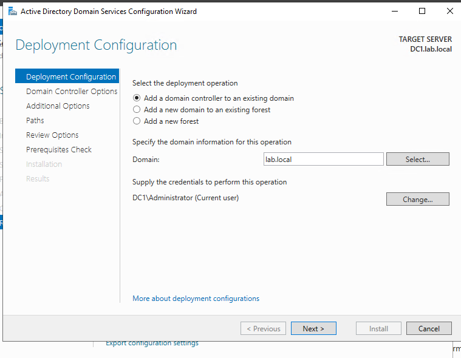

**Figure 8 — DC1 promotion configuration:** Adding DC1 to the existing lab.local Active Directory domain. Historical configuration — November 2026

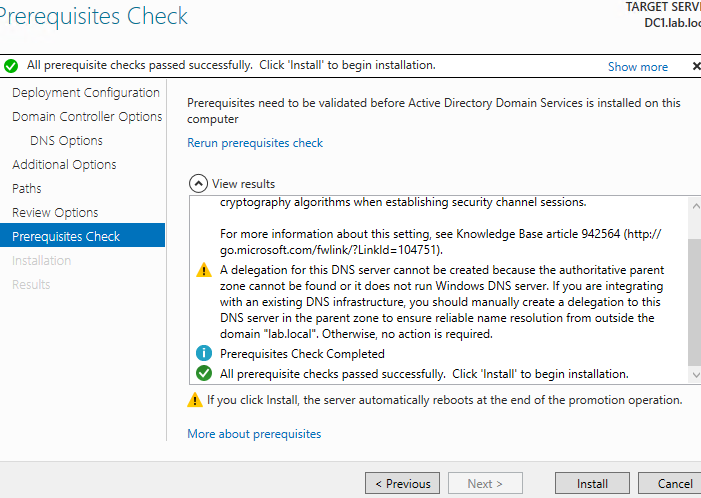

**Figure 9 — DC1 promotion prerequisite check:** All prerequisite checks passed before promotion. Historical configuration — November 2026

### Step 6 — Verify replication and domain shares

After promotion, I checked replication and verified that the SYSVOL and NETLOGON shares were available. The original checks showed no replication failures in the summary at that time.

```powershell
PS C:\Users\Administrator> repadmin /replsummary
```

```powershell
PS C:\Users\Administrator> net share
```

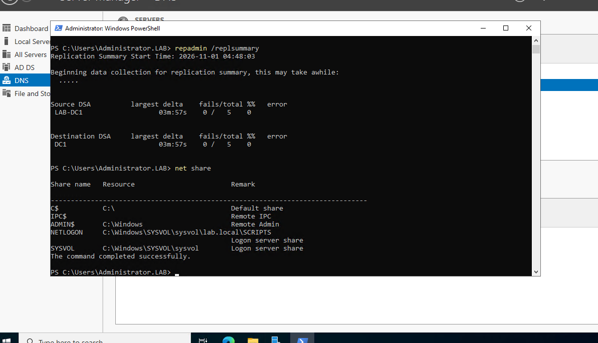

**Figure 10 — Replication and SYSVOL/NETLOGON verification:** Original command output checking replication and required domain shares. Historical configuration — November 2026

### Step 7 — Review DNS after promotion

I opened DNS Manager and checked the existing `lab.local` forward lookup zone and domain controller records. The screenshot below shows the DNS configuration during the original migration.

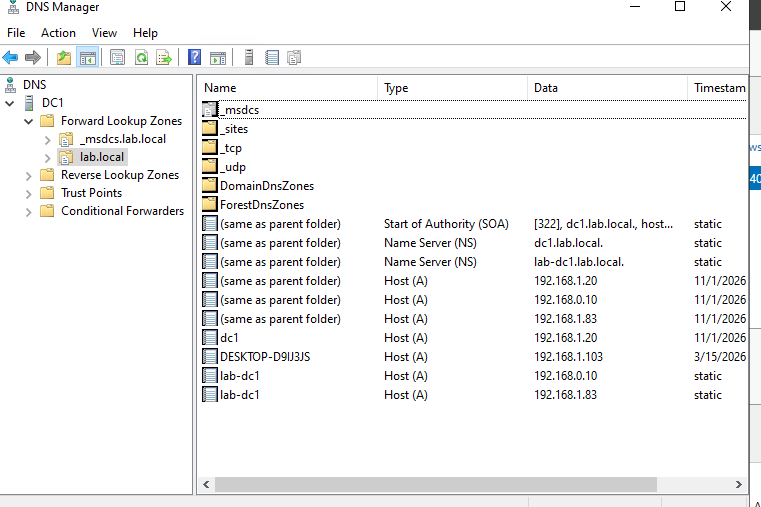

**Figure 11 — Migration DNS zone:** Original lab.local DNS records on DC1. Historical configuration — November 2026

### Step 8 — Transfer and verify FSMO roles

Once DC1 was working as a domain controller, I transferred the five FSMO roles from the physical server to DC1. I verified which server held each role with the command below.

```powershell
PS C:\Users\Administrator> netdom query fsmo
```

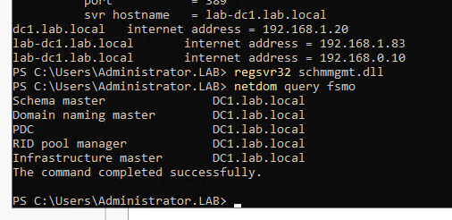

**Figure 12 — FSMO role verification:** All five FSMO roles are shown under DC1.lab.local in the original command output. Historical configuration — November 2026

### Step 9 — Demote the original physical domain controller

After verifying DC1, I demoted the original physical domain controller to a domain member and renamed the physical server LAB-HV1. I checked Active Directory Users and Computers to confirm DC1 was the remaining domain controller.

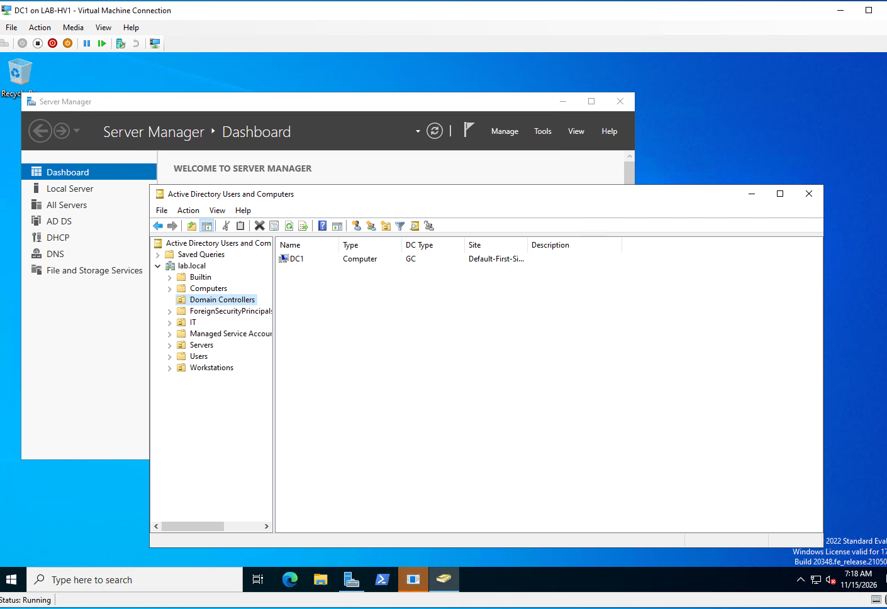

**Figure 13 — Domain controller after migration:** DC1 is the only server shown in the Domain Controllers organizational unit.

## 5. IP Addressing and DNS Verification

### Step 10 — Choose and configure current IP addresses

I checked the home network addressing and used consistent addresses for the servers. My router uses `192.168.0.1`, LAB-HV1 uses `192.168.0.10`, and DC1 uses `192.168.0.20`. DC1 uses a static IPv4 address and points its DNS configuration to itself because it hosts DNS for the Active Directory domain.

| Setting | Current value |
| --- | --- |
| Home network | 192.168.0.0/24 |
| Router / gateway | 192.168.0.1 |
| LAB-HV1 | 192.168.0.10 |
| DC1 | 192.168.0.20 |
| DC1 preferred DNS | 192.168.0.20 |

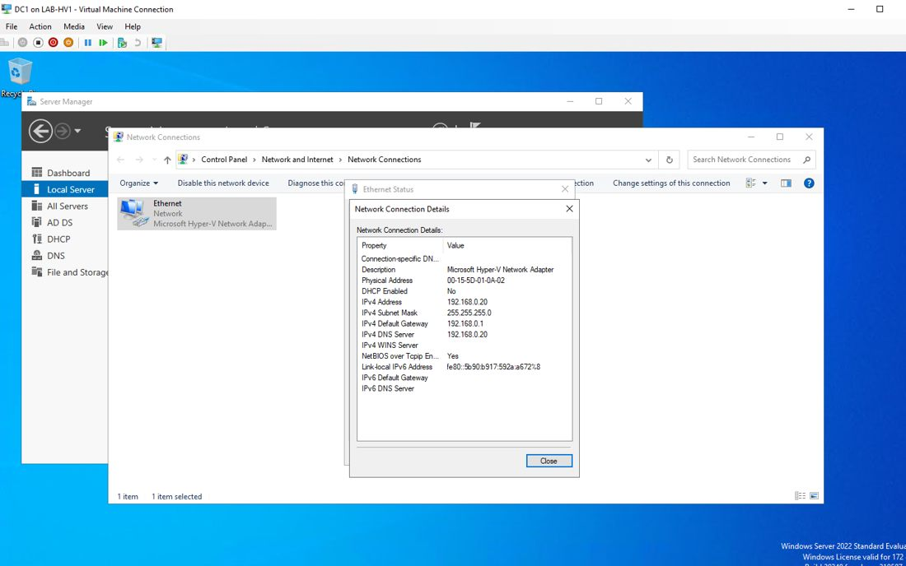

**Figure 14 — DC1 adapter configuration:** Network Connection Details showing static IPv4, gateway, and DNS settings.

### Step 11 — Verify IP settings using a command

I used `ipconfig /all` to check the active Hyper-V network adapter, static IP address, gateway, DNS servers, and DHCP-disabled setting on DC1.

```powershell
PS C:\Users\Administrator> ipconfig /all
```

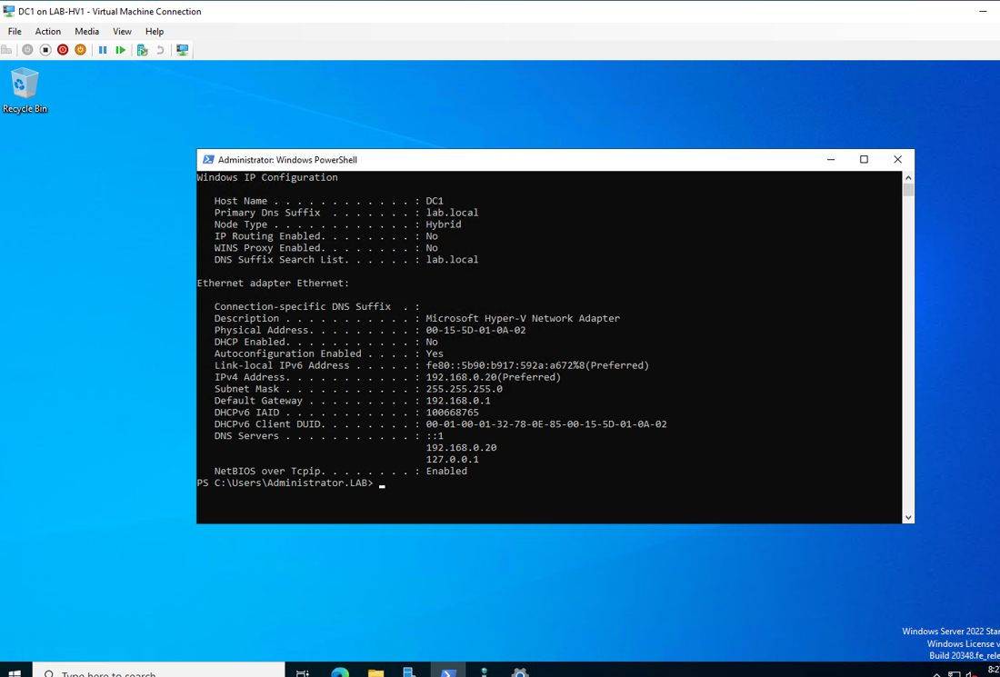

**Figure 15 — DC1 CLI network verification:** The command output confirms 192.168.0.20/24, gateway 192.168.0.1, and DHCP disabled on the adapter.

### Step 12 — Verify current DNS records

In DNS Manager, I checked the `lab.local` forward lookup zone. The Address Records for DC1 and LAB-HV1 point to their current IPv4 addresses.

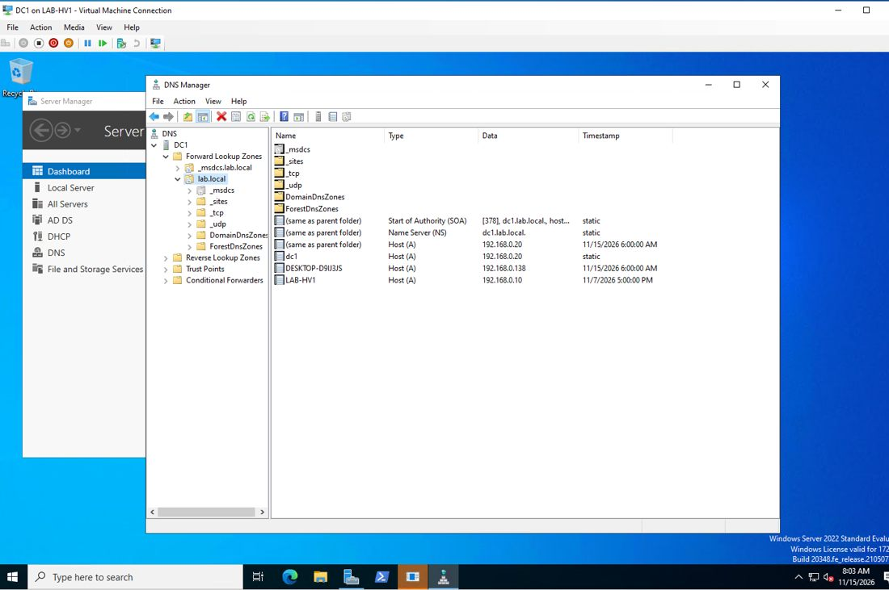

**Figure 16 — Current DNS Address Records:** DC1 and LAB-HV1 resolve through their configured records in the lab.local zone.

### Step 13 — Test DNS resolution

To verify more than just the configured records, I used `nslookup` on DC1. It returned the expected IPv4 address for `dc1.lab.local`.

```powershell
PS C:\Users\Administrator> nslookup dc1.lab.local
```

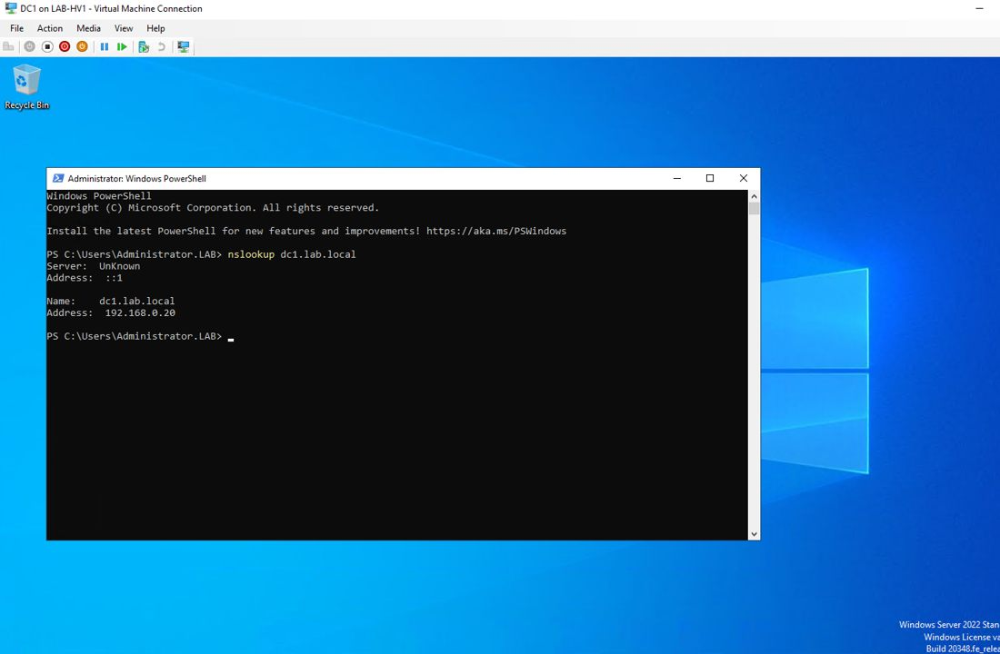

**Figure 17 — DNS lookup verification:** The command returned dc1.lab.local at 192.168.0.20.

## 6. DHCP Configuration — Currently Inactive

### Step 14 — Configure the initial address pool

I installed DHCP Server on DC1 and configured an initial address pool from `192.168.1.100` through `192.168.1.200`. That pool belongs to an earlier lab addressing plan and is **not an active range for the current 192.168.0.x home network**.

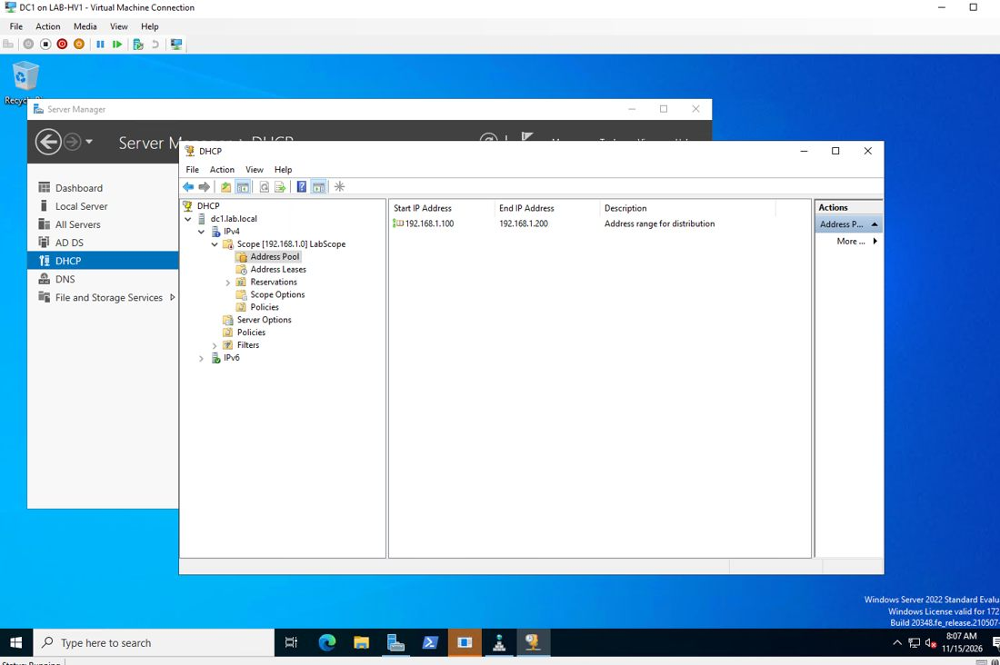

**Figure 18 — Original DHCP address pool:** Configured scope from 192.168.1.100 to 192.168.1.200, retained but not currently active.

### Step 15 — Verify DHCP is disabled for now

I intentionally left the DC1 DHCP scope inactive while the virtual machines share my home network. This avoids having two DHCP services distributing addresses on the same network. In DHCP Manager, I right-clicked the scope and verified that the available action was **Activate**, confirming it was currently inactive.

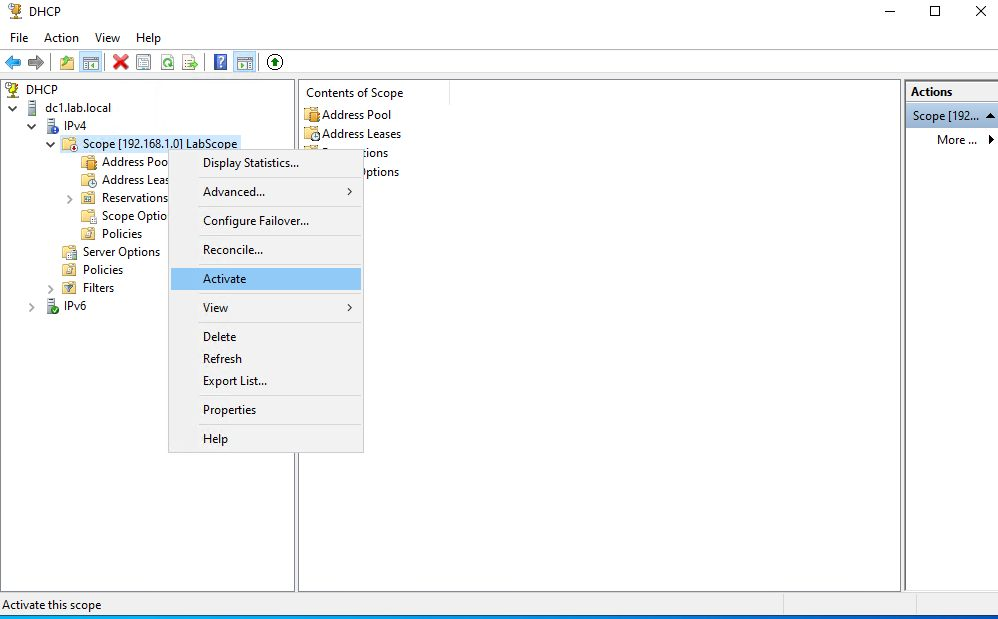

**Figure 19 — Inactive DHCP scope verification:** The context menu offers Activate, showing this DHCP scope is currently inactive.

## 7. Remote Administration

### Step 16 — Manage LAB-HV1 remotely

I use Remote Desktop from my main Windows 11 computer to manage LAB-HV1 without a separate monitor or keyboard attached to the server. I can access Server Manager and Hyper-V, capture documentation screenshots, and follow technical guides or instructional videos on my main PC while working through the lab.

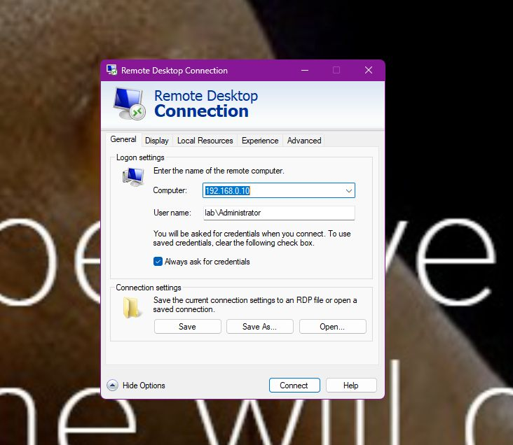

**Figure 20 — Remote Desktop connection settings:** Configured a connection to LAB-HV1 at 192.168.0.10.

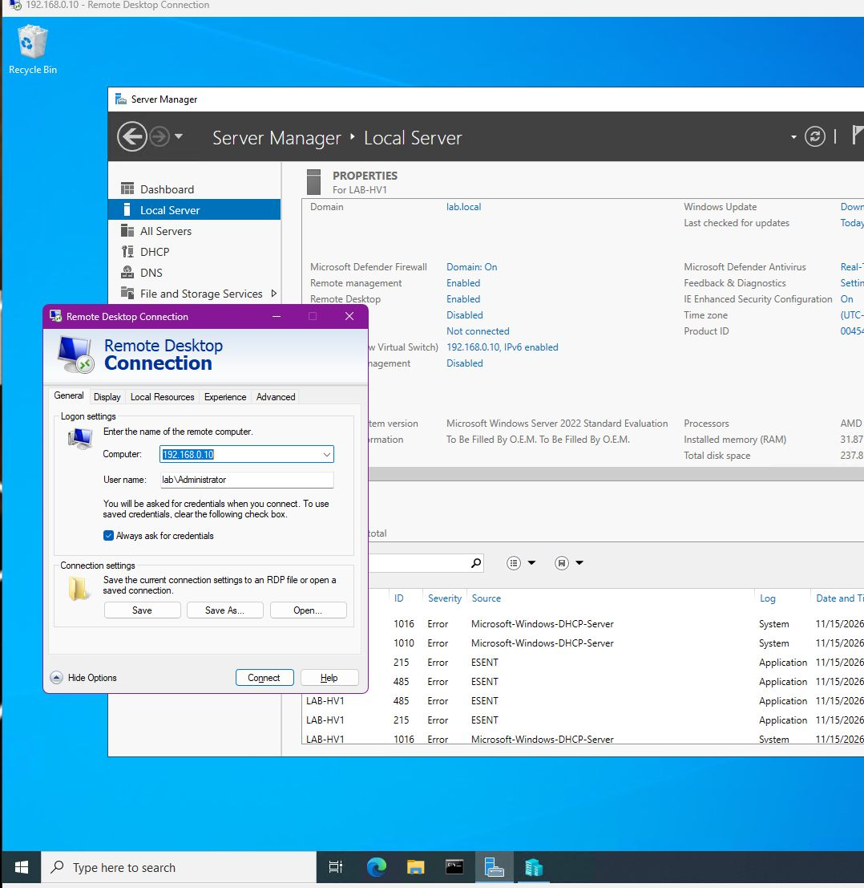

**Figure 21 — Remote management verification:** Connected to LAB-HV1 and accessed Server Manager through Remote Desktop.

## 8. Windows 11 Client — Domain Verification

### Step 17 — Verify domain membership

I joined my Windows 11 virtual machine to the `lab.local` domain. In Windows Settings, I verified that the full device name includes the domain. In Hyper-V the VM is labeled CLIENT1; the Windows guest still uses its default device name.

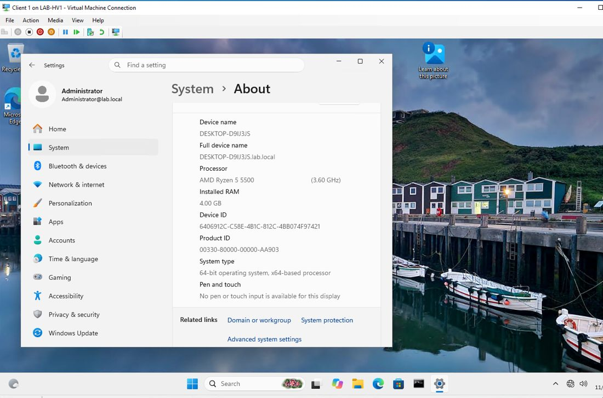

**Figure 22 — CLIENT1 domain membership:** Windows 11 device details show a lab.local fully qualified device name and a domain user context.

### Step 18 — Verify the active account

I ran `whoami` on the Windows 11 client to confirm that the signed-in session was using the lab domain account. This confirms the current user context, but by itself it is not proof of a fresh authentication exchange with DC1.

```bat
C:\Users\administrator> whoami
```

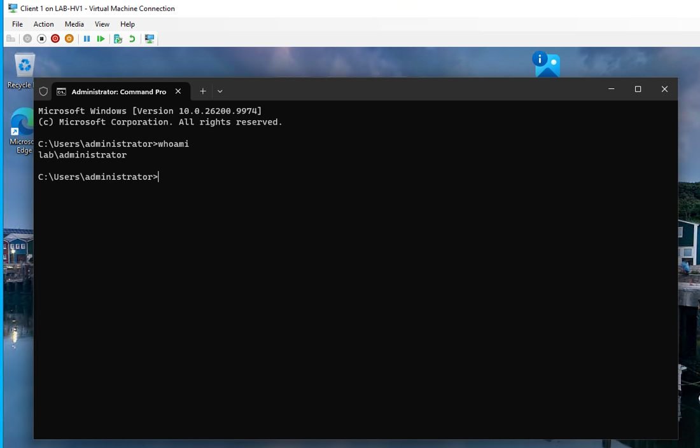

**Figure 23 — CLIENT1 domain account check:** Command Prompt returned lab\administrator.

## 9. Brief Troubleshooting Notes

During the migration and network configuration, I checked IP addressing, DNS settings, and network reachability while working through connectivity and name-resolution problems. I used configuration views and command-line checks to verify the final settings before moving on. The historical screenshots reflect earlier addresses; the newer screenshots show the current configuration.

I also made a full backup to a share on my main computer before major migration changes. Detailed backup and restore testing will be documented separately in the backup phase when verified.

> **Current progress:** This README shows the work completed and verified so far. Phase 01 remains **In Progress**; network isolation and future changes will be documented as they are implemented, not presented as already finished.

[← Back to Midwest Technology Home](../README.md)
